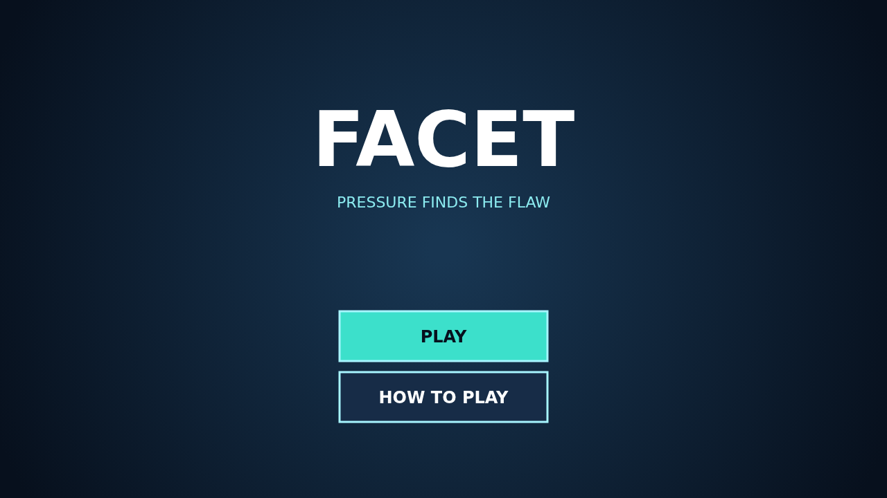

# Facet

Facet is a jewel-box puzzle where every swap can start an avalanche. Trade neighboring gems to line up three or more of one kind, then watch the stones above tumble into new matches.

Every clear presses on the gems left beside it. Pressure becomes cracks, cracks become flaws, and a flawed gem caught beside another clear erupts for double points. Planning where the board wears thin is the heart of a long chain.

Longer and crossing matches leave extraordinary cuts behind. A brilliant sweeps its surrounding ring, a star cuts through its entire row and column, and a prism traded with a gem takes every stone of that kind.

Each link in a chain raises the multiplier. Reach the growing target to open the next level—and keep the board alive before its last productive move disappears.

